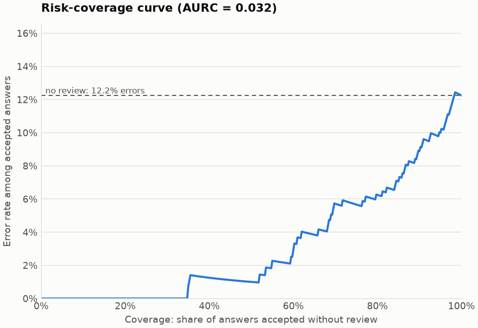
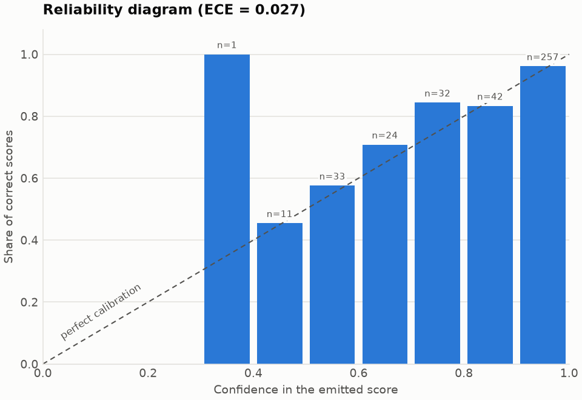

# asag-eval

[](https://github.com/9ani/asag-eval/actions/workflows/ci.yml)
[](https://github.com/9ani/asag-eval/releases/latest)
[](LICENSE)


Reproducible evaluation of automated short-answer grading (ASAG) models.

One evaluator takes the predictions of any model in one schema and always produces the
same set of tables and figures:

- **agreement** with the gold scores: quadratic weighted kappa (QWK), Cohen's kappa,
  macro-F1, accuracy, mean absolute error and the rate of extreme errors;
- **uncertainty**: 95% confidence intervals from a bootstrap over *questions*, and a
  paired test for the difference between two models;
- **calibration**: ECE, Brier score and negative log-likelihood;
- **selective prediction**: the risk-coverage curve, which shows what a confidence
  threshold buys when uncertain answers are sent to a teacher.

It is the evaluation component of [VeriGrade-ASAG](#background), a master's dissertation
project on risk-aware grading of students' short answers.

## Why another evaluation script

Two things usually go wrong when ASAG results are reported.

**The intervals are too narrow.** Answers to the same question share its wording, rubric
and difficulty, so they are not independent. A bootstrap over single answers ignores
that. `asag-eval` resamples whole questions. On the bundled example the 95% interval for
QWK is 0.177 wide with the question bootstrap and 0.124 with the answer bootstrap: the
usual method reports an interval that is 30% too narrow.

**Accuracy is reported, but the deployment question is not answered.** A grader that
supports a teacher does not need to be right everywhere. It needs to know where it is
likely to be wrong. The risk-coverage analysis shows how many answers can be accepted
automatically at a given error rate.

## Install

Python 3.11 or newer.

```bash
python -m pip install git+https://github.com/9ani/asag-eval.git
```

To pin the exact version a paper used, install the wheel attached to a
[release](https://github.com/9ani/asag-eval/releases):

```bash
python -m pip install https://github.com/9ani/asag-eval/releases/download/v0.1.0/asag_eval-0.1.0-py3-none-any.whl
```

## Quick start

The repository ships a synthetic example (no real student data): a model and a weaker
baseline that scored the same 400 answers to 40 questions.

```bash
asag-eval evaluate examples/sample_predictions.jsonl --out results
```

```text
| Metric | Value | 95% CI |
| --- | --- | --- |
| Quadratic weighted kappa (QWK) | 0.801 | [0.709, 0.886] |
| Cohen's kappa | 0.813 | [0.730, 0.894] |
| Macro-F1 | 0.877 | [0.820, 0.931] |
| Accuracy | 0.877 | [0.823, 0.930] |
| Mean absolute error | 0.180 | [0.102, 0.260] |
| Extreme error rate | 0.058 | [0.033, 0.087] |
```

`results/` then holds `metrics.json` (every number, machine-readable), `report.md`
(the tables) and three figures. The full output for the example is committed in
[examples/expected](examples/expected), starting with
[report.md](examples/expected/report.md).

| Risk-coverage curve | Reliability diagram |
| --- | --- |
|  |  |

Reading the left figure: with no review 12.2% of the grades are wrong. If only the 70%
most confident answers are accepted and the rest go to a teacher, 5.7% of the accepted
grades are wrong.

Compare two models on the answers both of them scored:

```bash
asag-eval compare examples/sample_predictions.jsonl examples/sample_baseline.jsonl --out results
```

```text
| Metric | A | B | A - B | 95% CI | p |
| --- | --- | --- | --- | --- | --- |
| Quadratic weighted kappa (QWK) | 0.800 | 0.530 | 0.270 | [0.192, 0.351] | 0.0010 |
```

Options: `--n-boot` (resamples, default 2000), `--seed` (default 0), `--n-classes`
(default 3, scores 0..2), `--bins` (confidence bins for ECE, default 10), `--no-plots`.
`python -m asag_eval` works as well as the `asag-eval` command.

### As a service

`asag-eval serve` puts the same evaluation behind HTTP, so a grading backend or a
notebook on another machine gets numbers from one tested implementation:

```bash
asag-eval serve --port 8080
curl -s localhost:8080/healthz
curl -s --data-binary @examples/sample_predictions.jsonl "localhost:8080/evaluate?n_boot=2000&seed=0"
```

`POST /evaluate` takes a predictions file as the body and returns the `metrics.json` that
`asag-eval evaluate` writes for it. Query parameters: `n_boot` (1 to 10,000), `seed`,
`n_classes`, `bins` and `name` (the file name recorded in the result). Invalid input gets
status 400 with the same one-line message as the command line; bodies over 20 MB get 413.

## Predictions schema

A JSON Lines file: one object per line, one line per graded answer.

```json
{"id": "q01-a03", "question_id": "q01", "true_score": 1, "predicted_score": 1, "score_probabilities": {"0": 0.04, "1": 0.91, "2": 0.05}}
```

| Field | Required | Meaning |
| --- | --- | --- |
| `id` | yes | Unique id of the answer: a string or an integer. |
| `true_score` | yes | Gold score, an integer from 0 to `n_classes - 1`. |
| `predicted_score` | yes | The model's score, or `null` if its output could not be parsed. |
| `score_probabilities` | no | Probability of each score; must sum to 1. Enables calibration and risk-coverage. Give it for every scored answer or for none. |
| `question_id` | no | The question the answer belongs to: the resampling unit of the bootstrap. |

Without `question_id`, a SciEntsBank-style id such as `EM.45b.299.1` is assigned to
question `EM.45b`; any other id becomes its own cluster, which reduces the method to the
ordinary answer-level bootstrap. The report says so explicitly when that happens. Other
fields are ignored, so a model can keep its raw output or latency in the same file.

Invalid files are rejected with the file name and line number. Answers without a
predicted score are excluded from the metrics and **counted in the report**, never
dropped silently.

## What is computed

| Quantity | Definition |
| --- | --- |
| QWK | Cohen's kappa with squared-distance weights: the standard ASAG metric for ordinal scores. |
| Extreme error rate | Share of answers graded at the opposite end of the scale (0 for 2, or 2 for 0). |
| Confidence | The probability the model gave to the score it emitted. |
| ECE | Mean absolute gap between confidence and accuracy over equal-width confidence bins. |
| Brier score | Mean squared distance between the probability vector and the gold score (0 to 2). |
| Risk-coverage curve | Error rate among the *k* most confident answers, for every *k*. |
| AURC | Mean of that error rate over all coverage levels; lower is better. |
| Confidence interval | Percentile bootstrap over questions. |
| p-value | Two-sided paired bootstrap test of "no difference", with the +1 correction. |

Agreement metrics are computed from the confusion matrix and are tested against
scikit-learn. A metric that is undefined (kappa when only one score occurs) is reported
as `null`, not as a made-up number.

A threshold cannot separate answers with equal confidence, so ties are handled as one
group: the risk-coverage curve uses the group's mean error, and the selective table
accepts every answer at or above the threshold. No result depends on the order of rows.

## Reproducibility

- The same file, seed and number of resamples give the same output, to the last digit.
  Nothing reads the clock or the environment.
- Every result records the SHA-256 of its input, the seed, the number of resamples and
  the tool version.
- The reference results in `examples/expected` are regenerated by the CI pipeline from
  the built wheel on every push, and the pipeline fails if a single digit changes.
- The container image fixes the whole environment: the base image is pinned by digest and
  every dependency by version and SHA-256 hash (`requirements.lock`,
  `requirements-dev.lock`). The Jenkins pipeline checks that the image, and the service
  deployed from it, return the committed `metrics.json` byte for byte.

## Technology choices

| Choice | Why | Considered instead |
| --- | --- | --- |
| Python 3.11+ | Language of the whole research stack (PyTorch, Transformers); the evaluator is imported by the same code that produces predictions. | R: strong statistics, but a second language in one project. |
| NumPy only at run time | All agreement metrics follow from one confusion matrix, so a bootstrap replicate is one `bincount`. 2000 resamples of 540 answers take 0.1 s, against 5.3 s with scikit-learn metrics in the loop. | scikit-learn at run time: correct, but about 50 times slower here and a heavy dependency. |
| scikit-learn in tests | An independent, widely used implementation to check the metrics against. | Hand-computed examples only: too few cases. |
| Matplotlib | The standard for publication figures; runs without a display. | Plotly: interactive, but papers need static figures. |
| argparse, JSON Lines | Standard library, no dependency. One record per line can be appended by a long GPU job and survives a crash. | Click/Typer; CSV (no nested probabilities). |
| pytest, ruff | The de-facto test runner; one fast tool for linting and formatting. | unittest; flake8 + black + isort (three tools). |
| GitHub Actions | Lives next to the code and is free for public repositories; runs the cross-platform test matrix. | GitLab CI. |
| Docker, multi-stage | One image for the checks and one for the service, built from the same wheel; pinned base and hashed locks. | Conda environment (pins Python packages, not the operating system). |
| Jenkins | Self-hosted, so it can deploy into a cluster that GitHub cannot reach, as data-protection rules require for real student answers. Configured as code. | GitHub Actions for deployment (needs a self-hosted runner anyway). |
| kind (Kubernetes in Docker) | A real Kubernetes API on a laptop for the staging environment; the same manifests work on any cluster. | Minikube (a VM), k3s (needs a Linux host). |

## Development

```bash
git clone https://github.com/9ani/asag-eval.git
cd asag-eval
python -m venv .venv
.venv/Scripts/activate        # Windows; on Linux/macOS: source .venv/bin/activate
python -m pip install -e ".[dev]"

ruff check . && ruff format --check .
pytest --cov
```

The CI pipeline ([.github/workflows/ci.yml](.github/workflows/ci.yml)) runs on every push
and pull request:

1. **Lint**: `ruff check` and `ruff format --check`.
2. **Test**: pytest on Python 3.11 to 3.14 (Linux) and 3.13 (Windows); coverage must stay
   at or above 90% and warnings are errors.
3. **Build**: source distribution and wheel, verified with `twine check`.
4. **Reproduce**: installs the wheel, regenerates `examples/expected` and fails on any
   difference from the committed results.

Delivery is automated as well ([.github/workflows/release.yml](.github/workflows/release.yml)):
pushing a version tag such as `v0.1.0` runs the same four jobs and, if they pass,
publishes the tested wheel and source distribution as a GitHub release.

Changes arrive through pull requests; see [CONTRIBUTING.md](CONTRIBUTING.md). Versions
are listed in the [CHANGELOG](CHANGELOG.md).

## Container and deployment (Docker, Jenkins, Kubernetes)

The [Dockerfile](Dockerfile) builds two images from one wheel:

```bash
docker build --target dev -t asag-eval-dev . && docker run --rm asag-eval-dev   # lint + tests
docker build -t asag-eval . && docker run --rm -p 8080:8080 asag-eval            # the service
docker run --rm -u "$(id -u)" -v "$PWD:/work" -w /work asag-eval \
  evaluate examples/sample_predictions.jsonl --out results                       # the CLI
```

The runtime image runs as a non-root user, stops cleanly on `SIGTERM` and reports its
health at `/healthz`.

A self-hosted Jenkins runs the [Jenkinsfile](Jenkinsfile) for every commit on every
branch; commits on `main` are also deployed to a staging Kubernetes cluster:

| Stage | What it does | Branches |
| --- | --- | --- |
| Lint & unit tests | Builds the `dev` image and runs ruff and pytest in it; publishes JUnit results and coverage. | all |
| Build image | Builds the runtime image, tagged with the commit. | all |
| Smoke test image | Starts the image and checks that it returns the committed `metrics.json` byte for byte ([ci/smoke_test.py](ci/smoke_test.py)). | all |
| Push to Docker Hub | Pushes the image; off until a registry credential is configured. | `main` |
| Deploy to staging | Loads the image into the kind cluster and rolls out [k8s/](k8s) (2 replicas, zero-downtime rolling update); rolls back if the rollout fails. | `main` |
| Smoke test staging | Repeats the smoke test through the Kubernetes service; rolls back on failure. | `main` |

The Jenkins controller and the cluster are code too ([ci/](ci)): plugins, the admin user,
the kubeconfig credential and the multibranch job are defined in
[ci/jenkins/casc.yaml](ci/jenkins/casc.yaml). Docker and kind must be installed; then

```bash
ci/up.sh   # kind cluster 'asag' + Jenkins on http://localhost:8080 (admin, password in ci/.env)
```

Jenkins polls this repository every minute, because a laptop has no public address for a
webhook. Staging answers on `http://localhost:30080`. To push images to Docker Hub, add a
username/token credential with the id `dockerhub` and set `DOCKERHUB_REPO`
(for example `docker.io/<user>/asag-eval`) as shown in `casc.yaml`.

## Limitations

- Percentile intervals are not bias-corrected. ECE in particular is biased upwards in
  resamples, so its interval can sit above the point estimate.
- The risk-coverage analysis uses raw model confidence; it does not fit a calibrator.
- Aggregation over several training seeds is not implemented yet.

Planned work is tracked in the [issues](https://github.com/9ani/asag-eval/issues).

## Background

VeriGrade-ASAG is the practical system of the master's dissertation "Development of an
Intelligent System for Analyzing and Evaluating Students' Short Text Answers Using NLP
Technologies" (Astana IT University). A fine-tuned language model proposes a 0/1/2 score,
a risk policy decides whether the answer can be accepted or must be reviewed, and a
teacher keeps the final word. This package produces the evidence for that policy.

## Citation

If you use this software in research, please cite it. GitHub shows the reference under
"Cite this repository"; the metadata is in [CITATION.cff](CITATION.cff).

## License

[MIT](LICENSE)
